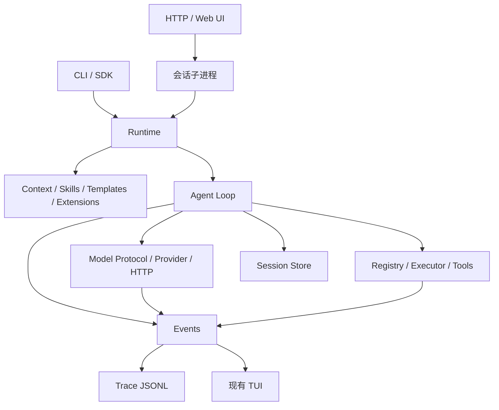

# 架构

| 层 | 可以依赖 | 不可以依赖 |
| --- | --- | --- |
| 数据模型 | 标准库 | SDK、终端 |
| Agent | 模型协议、executor、session、events | provider 实现、TUI |
| Provider | 数据模型、HTTP/SDK、events | 文件工具、会话策略 |
| Tools | 工具协议、workspace、资源 | loop、provider |
| Resources | 路径、文本解析 | 网络模型 |
| Runtime/CLI | 公共组件接口 | 绕接口修改内部状态 |
| TUI | events、用户命令 | 请求编码、工具实现 |

组装顺序：配置 → workspace → trace → 新建/恢复 session → 发现上下文/资源 → 显式扩展 → 注册工具 → system → provider → agent → 交互/单次运行。退出关闭客户端和记录器。

终端默认一个 Node 进程、一个活动 session。Web 服务按会话 fork 独立 Node 子进程，两者不依赖彼此的界面。模型请求和工具执行异步，工具仍按顺序运行；默认 OpenAI 兼容 Chat Completions、JSONL trace、JSON 快照和轻量 TUI。替换 provider/tool 不改 loop。
