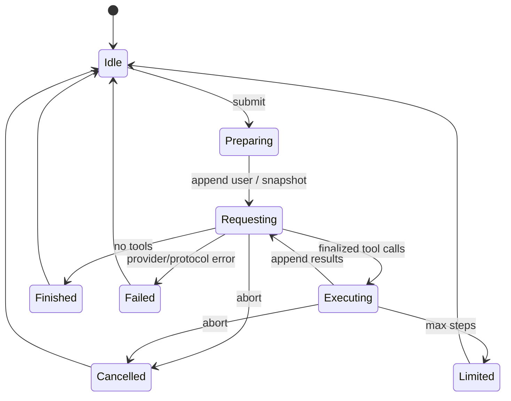

# 生命周期

session 是多轮对话；run 是一次用户提交；step 是一次模型请求；request 是一次 HTTP 尝试；call 是一个工具调用。

1. 检查取消与剩余步数；冻结 system/messages/tools，记录 request_start。
2. provider 编码并记录实际请求，顺序接收原始流和增量。
3. 完整响应校验后入历史；不完整的工具参数不得执行。
4. 按 assistant 中的顺序执行工具，记录完整结果并回填。
5. 保存一致快照；有工具继续请求，否则成功结束。

同一 agent 拒绝 run 重入。每个入历史的 tool_call 都必须有一个结果；工具组取消时补齐当前及剩余调用。中断流的部分文本只在 UI/trace，不恢复为完成响应。max_steps 到达后不额外请求模型。

agent_finish 带停止原因、步数、usage、耗时，标记本 run 结束。取消不回滚已有文件修改，用户通过 trace 判断已经发生的副作用。
